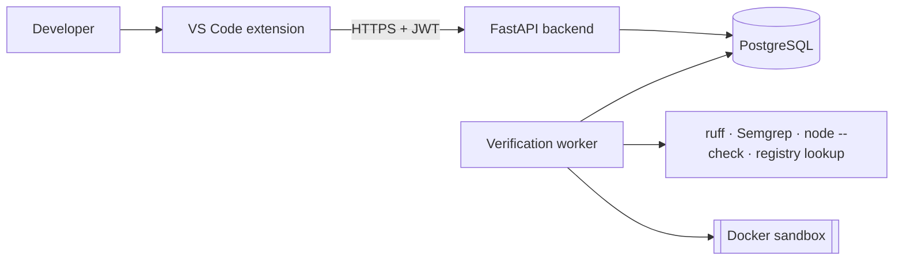

<div align="center">

# TrustCode

**Evidence-grounded verification of AI-generated code — and a controlled study of whether it helps developers trust AI code *appropriately*.**


</div>

---

## Why TrustCode?

AI coding assistants write code fast, but the code is often subtly wrong, insecure, or depends on packages that do not exist —
and developers using assistants can become **more confident in less secure code**. Fluent AI explanations do not fix this; they
can make people accept wrong answers *more* often.

TrustCode takes a different approach: instead of a confidence score or a persuasive explanation, it shows **verifiable evidence**
from real analysis tools, says exactly **what each check can and cannot tell you**, and makes **what was not verified** impossible to miss.

> There is deliberately **no overall “safe” score**. Each check reports its own status:
> `✓ No findings (within scope)` · `! Issue detected` · `✕ Check failed` · `– Not tested` · `? Requires human review`

## Features

- **Languages** — Python, JavaScript and TypeScript, each identified and parsed with its own parser; type-declaration files and partial selections are recognised and explained.
- **Independent checks** — syntax, static analysis (ruff), security patterns (Semgrep, 21 frozen rules with CWE/OWASP mapping),
  sandboxed unit tests with coverage gaps, and a dependency-existence check against package hallucination.
- **Isolated execution** — tests run only in a throw-away Docker container: no network, read-only filesystem, separate unprivileged
  user, CPU/memory/process limits, timeouts and authenticated results.
- **Adaptive explanations** — beginner / intermediate / advanced wording; the underlying evidence is identical at every level (enforced by tests).
- **Human in control** — accept / modify / reject with a confidence rating. TrustCode never edits your files.
- **Privacy by default** — explicit consent before any code is sent; code deleted right after analysis; LLM explanations off by default.
- **Research mode** — counterbalanced within-subjects experiment, frozen evidence snapshots, interaction logging and pseudonymous CSV export.

## Architecture



Details: [`docs/architecture/architecture.md`](docs/architecture/architecture.md) · API: [`docs/api/openapi.json`](docs/api/openapi.json) ·
Security: [`docs/security/threat_model.md`](docs/security/threat_model.md) · Decisions: [`docs/decisions/architecture_decisions.md`](docs/decisions/architecture_decisions.md)

## Live demo API

`https://trustcode-api.vercel.app` (static checks only; unit-test execution is disabled on the hosted service).
In VS Code settings set `trustcode.backendUrl` to that URL and `trustcode.mode` to `account`, then run **TrustCode: Sign In** → *Create account*.

## Quick start (local)

**Requirements:** Python 3.12+, Node 20+, Docker, VS Code ≥ 1.90.

```bash
# 1. Backend + verification engine
python3 -m venv .venv
.venv/bin/pip install -r backend/requirements-dev.txt -e verification-worker
docker build -t trustcode-sandbox:0.1 verification-worker/trustcode_worker/sandbox/image

# 2. Run the API (local single-user mode) and the worker
cd backend
TRUSTCODE_LOCAL_MODE=true TRUSTCODE_WORKER_MODE=queue ../.venv/bin/python -m uvicorn app.main:app --host 127.0.0.1 --port 8000
TRUSTCODE_WORKER_MODE=queue ../.venv/bin/python -m app.worker_main      # second terminal

# 3. Extension
cd extension && npm install && npm run compile && npx vsce package --no-dependencies
code --install-extension trustcode-0.1.0.vsix
```

Select AI-generated Python, JavaScript or TypeScript → right-click → **TrustCode: Verify Selected Code**.
Full guide: [`docs/user_guide/user_guide.md`](docs/user_guide/user_guide.md) · Deployment (Docker Compose, PaaS): [`deployment/README.md`](deployment/README.md)

## Testing

| Suite | Command | Result |
|---|---|---|
| Verification engine (incl. sandbox attack tests) | `.venv/bin/python -m pytest verification-worker/tests` | 25 passed |
| Backend API | `cd backend && ../.venv/bin/python -m pytest tests` | 31 passed (1 requires Docker) |
| Extension unit | `cd extension && npm test` | 13 passed |
| Extension in VS Code | `VSCODE_EXECUTABLE=… node extension/out/test/integration/run.js` | 5 passed |
| End-to-end (API + worker + sandbox) | `./scripts/e2e/run_e2e.sh` | 15/15 steps |
| Benchmark validation | `.venv/bin/python scripts/dataset_validation/build_benchmark.py` | 20/20 items |

Full report, including defects found and fixed: [`docs/testing/test_report.md`](docs/testing/test_report.md).

## The research

**Question:** Does tool-grounded, status-labelled evidence — compared with an AI explanation alone — improve the correctness and
calibration of developers' accept/reject decisions on AI-generated code? Does it cause *complacency* on defects the tools cannot see?

| | |
|---|---|
| Literature review (84 verified references) | [`research/literature_review.md`](research/literature_review.md) |
| Research gap & novelty | [`research/research_gap_analysis.md`](research/research_gap_analysis.md) · [`research/novelty_validation.md`](research/novelty_validation.md) |
| Research questions & hypotheses | [`research/research_questions.md`](research/research_questions.md) |
| Benchmark (correct · false alarm · tool-detectable bug · tool-blind bug) | [`datasets/README.md`](datasets/README.md) |
| Experimental protocol & analysis plan | [`research/experimental_protocol.md`](research/experimental_protocol.md) · [`research/statistical_analysis_plan.md`](research/statistical_analysis_plan.md) |
| Power analysis | [`research/analysis/power_simulation.py`](research/analysis/power_simulation.py) |

> **Study status:** the experiment has **not yet been run** (awaiting ethics approval). No empirical results are reported in this repository.
> The analysis pipeline has only been checked on clearly labelled synthetic data.

## Repository layout

```
extension/             VS Code extension (TypeScript)
web/                   Website and dashboard (Next.js 16, Tailwind 4, Three.js / React Three Fiber hero; see web/DESIGN.md)
backend/               FastAPI API, worker process, migrations, tests
verification-worker/   Verification engine, Semgrep rules, Docker sandbox
datasets/              Benchmark items, metadata and validation report
research/              Literature, methodology, protocol, analysis scripts
docs/                  Architecture, API, security, UX, testing, project status, brand guidelines (docs/brand)
deployment/            Dockerfiles, deployment guide and status
dissertation/          Dissertation draft (chapters needing data are marked pending)
presentation/          Slides, demo script, viva preparation
scripts/               Literature verification, benchmark build, end-to-end tests
```

Project status and open issues: [`docs/project/status.md`](docs/project/status.md) · [`docs/project/known_issues.md`](docs/project/known_issues.md)

## Responsible use

TrustCode reports what specific checks did and did not find. **Passing checks do not mean code is correct or secure.**
The sandbox is designed for a dedicated host; read the threat model before deploying it publicly.

## Acknowledgements

Developed as a final-year research project with substantial assistance from an AI coding assistant (Claude).
Built on [Semgrep](https://semgrep.dev), [ruff](https://docs.astral.sh/ruff/), [FastAPI](https://fastapi.tiangolo.com)
and the VS Code Extension API.

## License

Code: MIT. Benchmark items: CC-BY-4.0.
