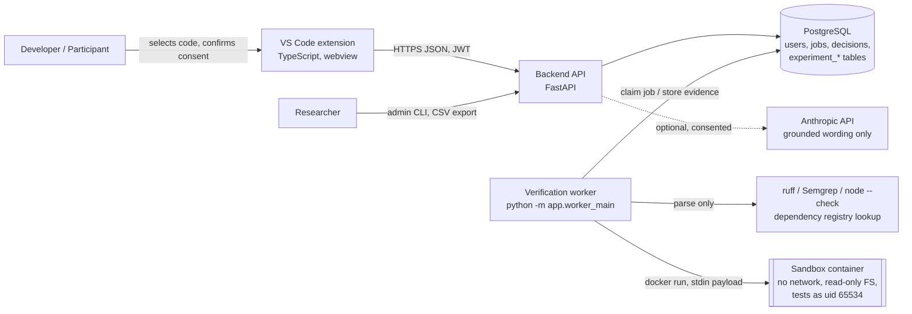
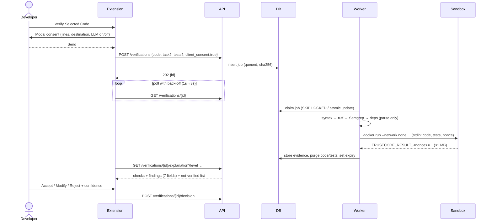
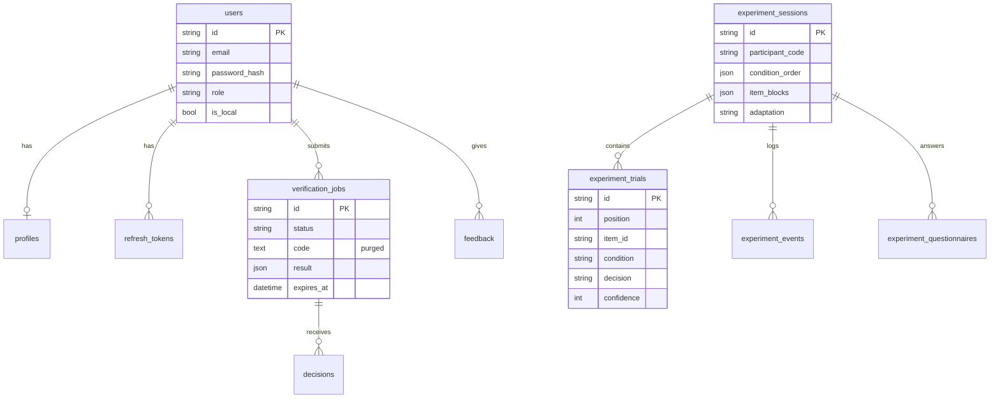
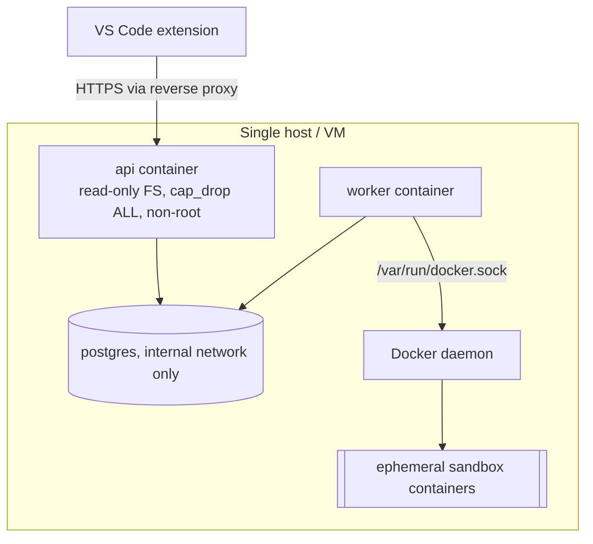

# TrustCode Architecture (as built, v0.1.0)

## 1. System context and components

| Component | Code | Responsibility |
|---|---|---|
| VS Code extension | `extension/src/` | Selection capture (explicit command), consent prompt, submission, progress + cancel, evidence/explanation display, level switch, decision + confidence, feedback, privacy settings, study mode |
| Backend API | `backend/app/api/routes.py` | Auth (JWT + rotating refresh, local mode), validation, rate limiting, job lifecycle, explanation/adaptation, decisions, feedback, experiments, export, audit log |
| Verification engine | `verification-worker/trustcode_worker/` | Language detection, syntax, lint (ruff), security (Semgrep frozen ruleset), sandboxed tests + coverage gaps, dependency existence, normalised `VerificationResult` |
| Worker process | `backend/app/worker_main.py` | Polls DB queue, runs pipeline, purges code, expires results; the only process with Docker access |
| Explanation engine | `backend/app/explanations/` | Deterministic 3-level templates; optional LLM wording validated against evidence |
| Adaptation engine | `backend/app/adaptation/engine.py` | Explicit level from profile; collapse rule; opt-in suggestions, never auto-switch |
| Research analytics | `backend/app/experiments/service.py` | Counterbalancing, frozen evidence presentation, event capture, pseudonymous CSV export |

## 2. Main sequence: verify selected code

## 3. Data flow and retention

| Data | Where | Retention |
|---|---|---|
| Source code, tests | `verification_jobs.code/tests` | Deleted immediately after analysis (tested: `test_code_purged_after_analysis`, deployment check) |
| Code hash, line count | `verification_jobs` | With the job |
| Evidence (incl. short code excerpts in findings) | `verification_jobs.result` | 24 h default; 30 days if the user enables history; then purged |
| Decisions, feedback | `decisions`, `feedback` | Until account deletion (`DELETE /me/data`) |
| Research data | `experiment_*` | Pseudonymous participant code only; separate tables; retention per ethics approval |
| Logs | stdout JSON | Method, path, status, duration, request id; **never bodies** |

## 4. ER diagram

(No foreign key links research tables to `users`: research data cannot be joined to accounts.)

## 5. Deployment architecture

Railway-style PaaS can host the API + managed PostgreSQL, but cannot run the Docker-based sandbox; the worker then
needs a separate VM (or `TRUSTCODE_RUN_TESTS=false`, which the UI reports honestly as "Not tested"). See `deployment/README.md`.

## 6. API specification
Generated from code: `docs/api/openapi.json` (21 paths). Error shape: `{"error": {"code", "message", "request_id"}}`;
pagination: `?limit&cursor` on `GET /verifications`; every response carries `X-Request-ID`.
