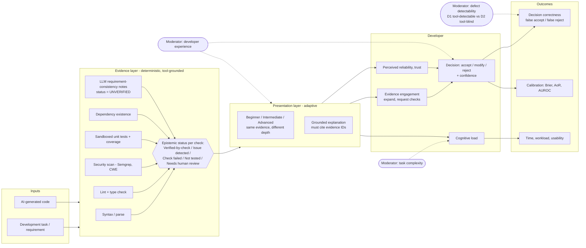

# TrustCode — Conceptual Framework

**Status:** Draft v0.1, 2026-11-03.

## 1. Theoretical foundations

| Theory / finding | Role in TrustCode |
|---|---|
| Trust calibration, resolution and specificity [lee2004trust] | Target outcome: reliance should match the code's actual correctness, item by item |
| Misuse / disuse [parasuraman1997humans]; automation complacency and bias [parasuraman2010complacency] | Predicts over-reliance on AI code, and possible complacency on "checks passed" evidence (H3) |
| Cost–benefit engagement with explanations [vasconcelos2023explanations] | Mechanism: evidence works by lowering the cost of verification, not by persuading |
| Explanations raise reliance regardless of correctness [bansal2021whole], [kim2025fostering], [steyvers2025know] | Design constraint: the LLM explains evidence and never adds verdicts |
| Checkable sources reduce reliance on wrong answers [kim2025fostering] | Analogue for tool evidence |
| Dual-process / cognitive forcing [bucinca2021trust] | Option: elicit an initial judgement or confidence before revealing the evidence summary (Phase 4 decision) |
| Appropriateness of Reliance [schemmer2023appropriate]; trust ≠ acceptance [baltes2026rethink] | Measurement model |

## 2. Framework diagram

## 3. Variables

| Type | Variable | Levels / measure |
|---|---|---|
| Independent (primary) | Interface condition | Baseline (code + LLM explanation) vs TrustCode (code + status-labelled tool evidence + grounded explanation) |
| Independent (secondary) | Presentation adaptation | Fixed (intermediate) vs adapted to declared expertise (exploratory) |
| Item-level factor | Item class | C1 correct-clean, C2 correct-spurious-warning, D1 tool-detectable defect, D2 tool-blind defect |
| Moderator | Developer experience | Self-report years + short pre-test (avoid sensitive profiling) |
| Dependent | Correctness, false accept/reject, Brier, AoR, AUROC, time, NASA-TLX, trust scale, SUS | See `research_questions.md` §4 |
| Process | Evidence engagement events | Logged |
| Controls | Same LLM, same items, same editor, counterbalanced order | — |

## 4. Design invariants derived from the framework

These carry forward into Phases 3–8 as requirements:

1. **Evidence is immutable.** The explanation engine reads evidence and can never write it. Changing explanation level never changes evidence or status.
2. **Every explanation sentence about a finding must reference an evidence ID.** Unreferenced claims are dropped or labelled *"AI interpretation — not verified"*.
3. **No aggregate correctness score.** Show per-check status and coverage, including what was *not* tested.
4. **LLM-derived judgements** (e.g., requirement mismatch) always carry the *Needs human review* status, never *Verified*.
5. **Human decides.** No auto-apply; the decision and confidence are captured with every submission in experiment mode.
